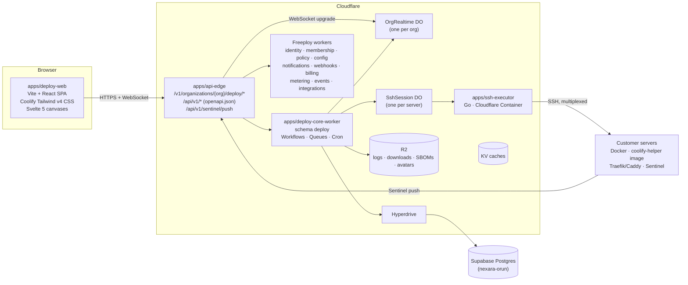

# freeploy-coolify-parity — design

The source is the spec. For every surface, the Coolify code at
`coollabsio/coolify@91b7e3e` (the model, the Livewire component, the Blade
view, the Action, the Job, the helper) is what Freeploy must do; this document
says **where** each piece lives in Freeploy and **how** "exact" is measured. The
generated inventory in `parity/` lists every unit by id and is the checklist.
Files derived from Coolify carry
`// Derived from coollabsio/coolify@91b7e3e:<path> (Apache-2.0), modified.`



## 1. The resource

### 1.1 The `deploy` schema

`packages/db` gains migrations `5xx_deploy_*` creating schema `deploy`. Its
tables are **Coolify's final schema at `91b7e3e`** — the fold of all 531
migration files that `parity/migrations.json` records (88 tables) — with the
same table and column names, so a Coolify query, model or fixture reads the
same against Freeploy. Three rules apply to every table:

1. `team_id` becomes `org_id uuid not null references identity.organizations`
   (Freeploy's org). Tables Coolify scopes only through a parent (for example
   `application_settings` through `applications.team_id` via
   environment → project) **also** get `org_id`, denormalised, so every row can
   be filtered by org without a join. 28 of the 88 tables have `team_id` today;
   after DP2 all 88 have `org_id`.
2. Coolify's `uuid` column stays and is the **public id** on every route and in
   `/api/v1` (Coolify's ids are cuid2 strings, not Freeploy prefixed ids). The
   bigint `id` stays internal. No new prefix is minted for ported resources;
   new Freeploy-only objects use Freeploy prefixed ids (`dpl_…`).
3. Columns Coolify encrypts (Laravel `encrypted` casts: private keys, env
   values, S3 secrets, notification tokens, webhook secrets, OAuth secrets) are
   stored as **envelopes**: AES-256-GCM ciphertext under a per-org data key,
   the data key wrapped by a platform key held as a Worker secret. Decryption
   of private keys happens only inside `ssh-executor` (§4.1).

The main groups (full list in `parity/migrations.json`):

```
projects, environments                      uuid, org_id, name, description …
applications, application_settings,
  application_previews,
  application_deployment_queues             the app, its 80+ settings, previews, the deploy queue
services, service_applications,
  service_databases                         one-click services and their parts
standalone_postgresqls … standalone_clickhouses   the eight engines
servers, server_settings, private_keys,
  standalone_dockers, swarm_dockers          servers, keys (encrypted), destinations
github_apps, gitlab_apps, gitea_apps         sources
s3_storages, scheduled_database_backups,
  scheduled_database_backup_executions       backups
environment_variables,
  shared_environment_variables               env, scoped team/project/environment/server
tags, taggables, scheduled_tasks,
  scheduled_task_executions                  tags and cron
*_notification_settings                      email, discord, telegram, slack, pushover, webhook
local_persistent_volumes, local_file_volumes persistent storage and file mounts
personal_access_tokens                       → identity API keys (org-scoped, Coolify abilities)
image_scans, image_sboms, github_runner_*,
  managed_dns_records, ssl_certificates,
  cloud_provider_tokens, resource_links, …   DP11 features
subscriptions, audit_events, passkeys,
  oauth_identities, oauth_settings           mapped onto Freeploy billing, events and identity
```

`teams`, `users`, `team_user`, `team_invitations`, `sessions`,
`password_reset_tokens` are **not** ported as tables: they are Freeploy's
identity and membership. A view `deploy.teams` maps Freeploy orgs to Coolify's
team shape (including `personal_team`, `show_boarding`) so ported queries keep
working. `instance_settings` becomes `deploy.platform_settings`, readable and
writable only by platform-admin (§3.4).

### 1.2 Server-side objects (unchanged)

Nothing on the customer's server changes: the same `coolify-helper` image for
builds, the same Traefik or Caddy configuration and labels, the same Docker
networks as destinations, the same Sentinel agent and the same
`/data/coolify/*` paths. A server managed by Coolify and one managed by
Freeploy are indistinguishable from the server's side. (The path keeps its
name because changing it would change every generated command; it is not
user-visible brand.)

## 2. The API

### 2.1 Console facade (Freeploy conventions)

`apps/api-edge` gains `deploy-facade.ts`, forwarding
`/v1/organizations/{org}/deploy/*` to `deploy-core-worker` after Freeploy's actor
resolution, policy check and rate limit. Envelopes are Freeploy's
`{ data, meta }` and errors Freeploy's `{ error: { code, message, details } }`;
validation errors carry Coolify's exact messages in `details.fields`.

```
GET    /v1/organizations/{org}/deploy/projects
POST   /v1/organizations/{org}/deploy/projects
GET    /v1/organizations/{org}/deploy/projects/{uuid}
…      one route group per Livewire component's data and actions
POST   /v1/organizations/{org}/deploy/applications/{uuid}/actions/{deploy|restart|stop|…}
GET    /v1/organizations/{org}/deploy/realtime            → WebSocket to OrgRealtime
```

The route list is derived from `parity/livewire.json`: each Livewire
component's public props become a GET shape and each action a POST, so the
SPA and the facade are generated from the same inventory row.

### 2.2 `/api/v1` — exactly Coolify's API

`/api/v1/*` on `api-edge` implements **every operation in Coolify's
`openapi.json`** (copied verbatim to `parity/openapi.json`; 292 operations,
349 routes in `routes/api.php`) with the same paths, bodies, status codes
and error texts. Auth is a bearer API token (Coolify's Sanctum abilities:
`read`, `write`, `deploy`, `read:sensitive`, `root`), stored as a Freeploy
identity API key bound to **one org**; `root` maps to org owner, never to
platform-admin. `/api/v1/sentinel/push` and `/api/v1/deploy` webhooks match
Coolify's endpoints.

## 3. The console

### 3.1 `apps/deploy-web`

A Vite + React + TypeScript SPA served by Workers Static Assets. Styling is
Coolify's own Tailwind v4 setup copied verbatim (`resources/css/app.css`,
`utilities.css`, `fonts.css`, fonts, theme tokens). It replaces Freeploy's
`web-console-next` as the product's surface; Freeploy's console keeps the
account pages it already owns (and is linked from Settings).

- **URLs** are exactly `routes/web.php` (290 routes in `parity/routes.web.json`),
  e.g. `/project/{project_uuid}/environment/{environment_uuid}/application/{application_uuid}/deployment/{deployment_uuid}`.
- **Blade → React.** Each of the 145 components in
  `resources/views/components/**` becomes a React component with the same DOM,
  Tailwind classes, props and slots, and the same Alpine behaviour (dropdowns,
  modals, tabs, confirmations with typed confirmation, copy buttons, toasts).
  Each of the 291 Livewire classes becomes a page or section component with
  the same fields, defaults, validation (Laravel rules → Zod, Coolify's
  messages) and states; `wire:poll` and Echo listeners become `OrgRealtime`
  subscriptions.
- **Copy** comes from `parity/strings.json` verbatim, brand words excepted.
- **Canvases.** The 22 Svelte components in `resources/js/**` mount as Svelte 5
  islands through a thin React wrapper.
- **Themes, appearance settings and breakpoints** match.
- **Brand.** Freeploy logo, favicon and name only, same size and placement.

### 3.2 Screens by area

Every route in `parity/routes.web.json` is a screen; its `milestone` field says
when it lands. The areas follow the feature map: auth and profile (DP3);
servers, keys, proxy, destinations, terminal (DP4); projects, environments,
applications, deployments, logs (DP5); sources and previews (DP6); databases
and storages (DP7); services (DP8); tags, shared variables, notifications,
scheduled tasks, security/API tokens (DP9); team, members, audit log, Boarding,
subscription (DP10); canvases and advanced features (DP11); settings and admin
(DP12).

### 3.3 Realtime

One `OrgRealtime` Durable Object per org carries Coolify's broadcast events
with the same names and payloads (`parity/events.json`: 29 events, e.g.
`ApplicationStatusChanged`, `ServiceStatusChanged`, `ProxyStatusChanged`,
deployment log lines). It replaces Soketi/Pusher, Laravel Echo and every
`wire:poll`. A socket is admitted only after `api-edge` resolves the actor
and their membership of that org.

### 3.4 Platform admin

Coolify's instance-scoped features (`/settings/*`, `/admin`, self-update,
instance backups, root-team powers) are reproduced with the same UI under the
Freeploy operator role, enforced in `policy-worker`; no customer org can reach
them (tests in DP12).

## 4. Events, secrets, and integrations

### 4.1 SSH executor

- `apps/ssh-executor`: a Go service (`golang.org/x/crypto/ssh`) deployed as a
  Cloudflare Container, reachable only from the `SshSession` Durable Object
  (one per server, in `deploy-core-worker`). API: `exec(commands[], {timeout,
  stream})` with `remoteProcess.php`'s `set -e` and quoting semantics,
  streaming stdout/stderr lines and exit codes; `upload(path, content, mode)`;
  `pty(open|resize|write|close)` for the web terminal.
- The private-key envelope is decrypted inside the executor per request and
  never logged. Host keys are trusted on first use and pinned (shown in the
  UI). Connection reuse is per `SshSession`, closed after Coolify's idle
  window. Rotation follows `RotatePrivateKeyJob` and
  `RemoveRotatedAuthorizedKeyJob`.
- Command strings are produced only by the TypeScript ports of
  `bootstrap/helpers/*.php` and the Actions, held byte-equal to Coolify by
  golden tests (§4.5). Every exec is written to the audit log (org, server,
  actor, command hash, exit code).

### 4.2 Jobs → Workflows, Queues and Cron

- Long or multi-step jobs (`ApplicationDeploymentJob`, `DatabaseBackupJob`,
  `VolumeBackupJob`, `ValidateAndInstallServerJob`, transfers, migrations)
  become Cloudflare Workflows in `deploy-core-worker`, each step one-to-one
  with the job's steps: same order, retries, timeouts and status transitions
  (`parity/jobs.json` records `tries`, `timeout`, `backoff` per job).
  `ApplicationDeploymentJob` becomes `application-deployment.workflow.ts`.
- The rest become Queue consumers. Every message carries `org_id`; a consumer
  refuses a message whose resource is not in that org.
- `ScheduledJobManager` and the console schedules become Cron Triggers that
  enqueue org-scoped work. Per-resource cron (scheduled tasks, backups) is
  evaluated with the same cron semantics and timezone handling as
  `bootstrap/helpers/timezone.php`.

### 4.3 Integrations and notifications

- Sources: GitHub Apps (manifest flow), GitLab, Gitea, Bitbucket, deploy keys,
  in `deploy-core-worker`, with webhook ingress through Freeploy's
  `webhooks-worker` verifier.
- Notifications: the six channels × every event in `parity/notifications.json`
  (207 rows). Email goes through Freeploy's `notifications-worker`; Discord,
  Telegram, Slack, Pushover and webhook are sent by `deploy-core-worker` with
  payloads byte-equal to Coolify's.
- Billing: Coolify's Subscription pages over Freeploy's Polar billing; metering
  counts servers and resources per org.
- Hetzner: cloud-provider tokens are org-scoped encrypted credentials.

### 4.4 Storage

R2 for the deployment-log archive, file downloads (`PrepareFileDownloadJob`),
SBOMs and avatars; Postgres via Hyperdrive for relational data; KV for caches;
Workers Analytics Engine (or Postgres with Sentinel's retention) for metrics.

### 4.5 Measuring "exact" — `tools/parity`

- **Reference instance:** Coolify at `91b7e3e` on a CI runner with Docker,
  seeded with deterministic fixtures through its API (team, users, key, test
  servers, a project with environments, one app per build pack, each database,
  three services, S3, notifications, tags, shared variables, scheduled tasks);
  the same fixtures go to Freeploy stage through `/api/v1`.
- **Visual:** Playwright over every route in `routes.web.json` at 1440×900 and
  390×844, light and dark, states empty/filled/error/modal; `pixelmatch` with
  masks only for timestamps, uuids, charts, avatars and the brand logo.
  Gate ≤ 0.5% differing pixels per screenshot.
- **DOM and copy:** visible text and form-field names/types compared exactly,
  brand words normalised.
- **API:** contract tests from `openapi.json` against both systems, responses
  compared field by field after normalising ids and timestamps; gate 100%.
- **Commands:** golden tests feed the same fixtures to Coolify's PHP helpers
  (in the reference container) and to the TypeScript ports; command strings,
  compose files, proxy labels and build arguments compared byte for byte.
- **Behaviour:** end-to-end scenarios on throwaway test servers in both
  systems; final `docker ps`, labels, networks, volumes and visible status
  compared.
- **Report:** `parity/README.md` regenerated by CI on every merge.

## 5. Out of scope

- Running builds on Cloudflare. Builds run on the customer's server inside the
  helper container, as in Coolify.
- Following Coolify `main`. `COOLIFY_REF` moves only in its own task and PR,
  which regenerates the inventory and mints a milestone for the delta.
- Coolify's trademarks: name, logo, wordmark, "Coolify Cloud". Third-party
  service logos in `public/svgs` stay only where Coolify uses them to identify
  a service.
- Self-hosting Freeploy as a single-tenant install. The product is the hosted,
  multi-tenant control plane.
- Sharing anything across orgs: servers, keys, sources, storages and resources
  each belong to exactly one org.
